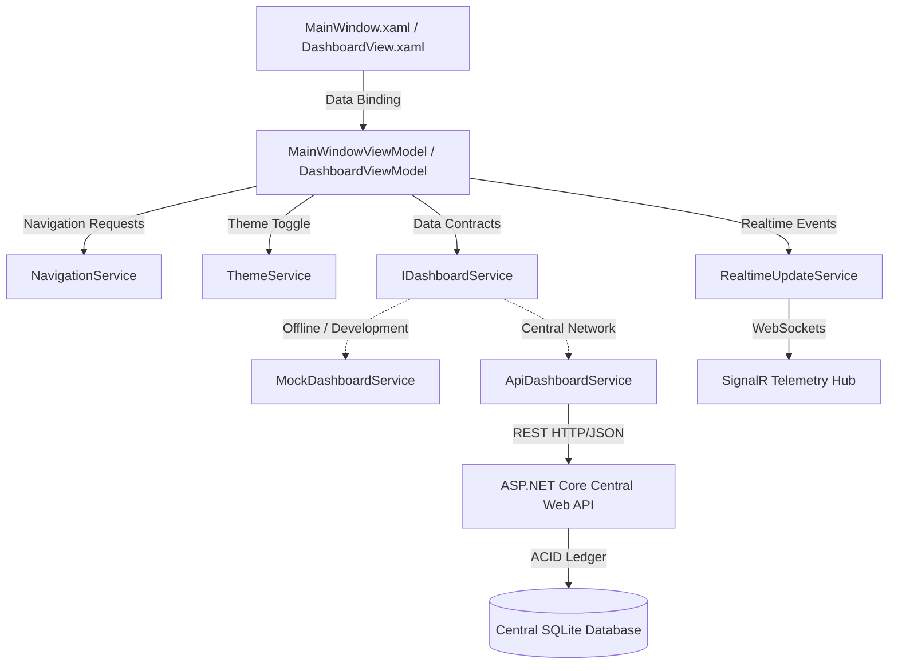
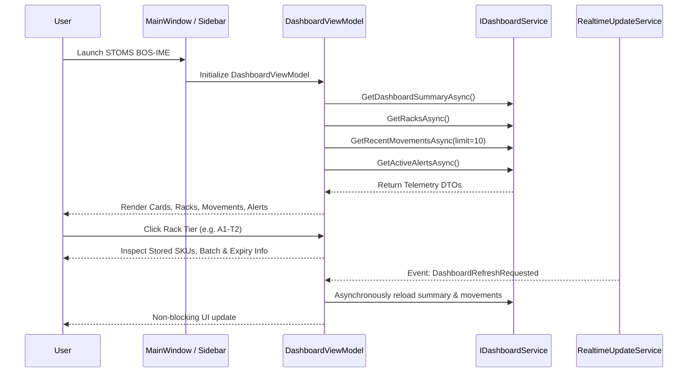

# STOMS Business Operating System — Inventory Management Engine (BOS-IME)
## Step 1: Home Dashboard & Core Architecture Documentation

### 1. Executive Summary & Module Scope
The **Home Dashboard** is the foundational telemetry hub for the **STOMS Business Operating System — Inventory Management Engine (BOS-IME)** desktop suite built on modern **.NET 8 WPF**. It provides an industrial ERP-grade operational overview of warehouse facilities, rack topology, SKU levels, batch expiry risks, pending sign-offs, and movement transactions.

---

### 2. Architectural Blueprint

---

### 3. Key Architectural Layers

#### A. Presentation Layer (WPF / XAML)
- **Centralized Theming (`Resources/`):**
  - `DarkTheme.xaml`: High-contrast slate/charcoal industrial dark mode.
  - `LightTheme.xaml`: Clean industrial light mode.
  - `Colors.xaml`: Reusable status colors (Emerald, Amber, Crimson, Purple, Blue).
  - `Styles.xaml`: Standardized cards, buttons, text inputs, comboboxes, and custom slim scrollbars.
  - `Icons.xaml`: Resolution-independent vector XAML Path Geometries for crisp rendering on high-DPI displays without font or image dependencies.
- **Dynamic Theme Service (`ThemeService.cs`):** Swaps merged resource dictionaries at runtime without requiring an application restart.

#### B. MVVM Core (`Common/`)
- `ObservableObject`: Fast, thread-safe implementation of `INotifyPropertyChanged` using `CallerMemberName`.
- `RelayCommand` & `RelayCommand<T>`: Reusable commands for synchronous UI bindings.
- `AsyncRelayCommand`: Asynchronous command tracking background execution state (`IsExecuting`) for long-running network operations.

#### C. Domain Models (`Models/`)
1. **`DashboardSummary`:** Aggregate metrics calculating distinct active SKU count, unit-aware aggregate stock, low stock count, near-expiry count, expired count, and pending approval count.
2. **`Warehouse`:** Represents facility logistics nodes, coordinates, and aggregate tonnages.
3. **`Rack`:** Represents vertical multi-tier storage bays with capacity thresholds, overall health status, and accordion preview toggles.
4. **`RackSection`:** Shelf tier representing weight/load capacities, stored SKU assignments, and empty-tier states.
5. **`StoredProductItem`:** Stored item model tracking SKU, batch numbers, native units, expiry dates, and reorder levels.
6. **`StockMovement`:** Auditable inventory transaction model tracking movements (`StockIn`, `StockOut`, `Transfer`, `Return`, `Damage`, `Adjustment`), source/destinations, users, and statuses.
7. **`InventoryAlert`:** Actionable warnings with severity classifications (`Info`, `Warning`, `Critical`) and relative timestamps.
8. **`UserProfile`:** Authenticated session identity with RBAC role representation.

#### D. Service Abstraction (`Services/`)
- `IDashboardService`: Contract separating the UI from the data origin.
- `MockDashboardService`: Realistic industrial test dataset clearly marked `[DEMO DATA]` for offline development.
- `ApiDashboardService`: Prepared ASP.NET Core Web API client consuming REST endpoints.
- `RealtimeUpdateService`: SignalR abstraction triggering asynchronous dashboard refreshes when transactions occur across network workstations.

---

### 4. Data Flow & Telemetry Sequence

---

### 5. Warehouse Topology Hierarchy
The physical hierarchy supported by the engine:
$$\text{Warehouse} \longrightarrow \text{Rack} \longrightarrow \text{Section (Shelf Tier)} \longrightarrow \text{Compartment / Bin} \longrightarrow \text{Stored Products}$$

- **Capacity & Occupancy Rules:**
  - If capacity is defined: $\text{Occupancy \%} = \frac{\text{Occupied}}{\text{Max Capacity}} \times 100$
  - If capacity is `null` or unconfigured: UI shows `"Capacity not configured"` (no fabricated percentages).
  - Empty shelf tiers display clear operational status: *"Empty Storage Tier (Available for Goods Inward allocation)"*.
