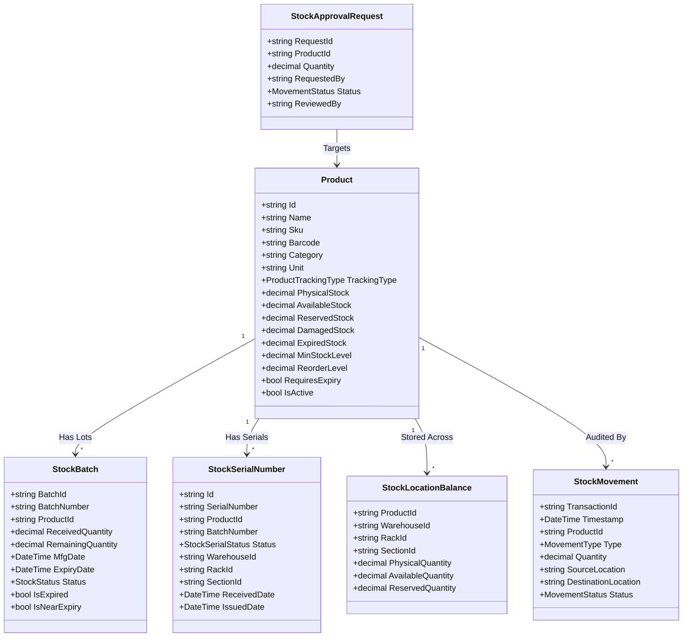

# STOMS Industrial Stock & Warehouse Management System
## Step 2: Product & Stock Management Engine Architecture Specification

**Author:** Hardik Jariwala  
**Component:** STOMS-BOS-IME / Module MOD-PRD-02 & MOD-STK-03  
**Target Platform:** .NET 8 WPF / C# 12 / Central ASP.NET Core API  

---

### 1. Architectural Domain Model

---

### 2. Inventory Math & Balance Principles

1. **Physical Stock:**
   Total actual quantity stored inside the physical warehouse bays.
   $$\text{Physical Stock} = \sum_{\text{Bays}} \text{Recorded Quantity}$$

2. **Reserved Stock:**
   Stock allocated to pending issue requests or sales orders awaiting supervisor sign-off.
   $$\text{Reserved Stock} = \sum_{\text{Pending Approvals}} \text{Requested Quantity}$$

3. **Unavailable Stock:**
   Stock that is physically held but cannot be issued for normal operations:
   $$\text{Unavailable Stock} = \text{Reserved Stock} + \text{Damaged Stock} + \text{Expired Stock}$$

4. **Available Stock (The Golden Truth):**
   $$\text{Available Stock} = \text{Physical Stock} - \text{Unavailable Stock}$$
   Negative values are strictly rejected by the backend validation layer.

---

### 3. API Contract Specifications (ASP.NET Core Web API)

The `ApiInventoryService` connects to the central ASP.NET Core Web API with the following REST routes:

| HTTP Verb | Route | Description |
| :--- | :--- | :--- |
| `GET` | `/api/v1/products` | Paginated search with multi-field filters (`search`, `category`, `trackingType`, `status`, `warehouseId`, `isActive`). |
| `GET` | `/api/v1/products/{id}` | Retrieves full product master specification. |
| `GET` | `/api/v1/products/generate-sku?category={cat}&name={name}` | Generates unique category-prefixed SKU. |
| `GET` | `/api/v1/products/validate-sku?sku={sku}` | Verifies SKU uniqueness across the catalog. |
| `GET` | `/api/v1/products/validate-barcode?barcode={code}` | Verifies barcode uniqueness when supplied. |
| `POST` | `/api/v1/products` | Creates a new product master record with default location. |
| `PUT` | `/api/v1/products/{id}` | Updates existing product details while protecting existing SKU integrity. |
| `POST` | `/api/v1/stock/receive` | Receives stock (GRN) into a designated bay, registers batches/serials, and logs movement. |
| `POST` | `/api/v1/stock/issue` | Issues stock or creates a reservation approval request if authorization is required. |
| `GET` | `/api/v1/stock/batches?productId={id}` | Retrieves all batches sorted by FEFO (First Expired, First Out). |
| `GET` | `/api/v1/stock/serials?productId={id}&status={status}` | Retrieves serial numbers for a product by status. |
| `GET` | `/api/v1/stock/approvals/pending` | Retrieves all pending sign-offs. |
| `POST` | `/api/v1/stock/approvals/{id}/approve` | Finalizes approved issue request and deducts physical stock. |
| `POST` | `/api/v1/stock/approvals/{id}/reject` | Rejects issue request and releases reserved stock. |

---

### 4. FEFO (First Expired, First Out) Algorithm

When issuing batch-tracked items with expiration dates:
1. Batches are sorted in ascending order of `ExpiryDate`.
2. Any batch with `ExpiryDate < DateTime.Today` is flagged as `Expired` and locked from standard issue.
3. Batches with valid future expiration dates are evaluated. The earliest expiring batch with sufficient remaining balance is prioritized as the default recommendation.
4. Users can manually choose another valid batch if approved by supervisor.

