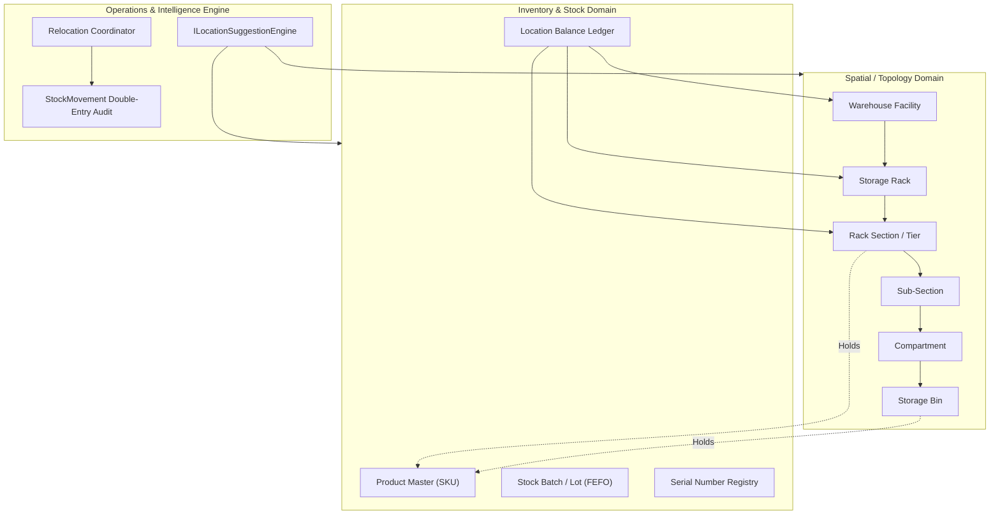

# Architecture Specification — Step 3: Warehouse & Rack Management Engine

**Lead Engineer:** Hardik Jariwala  
**System Architecture:** MVVM (Model-View-ViewModel) with WPF Desktop & Central REST/SignalR API  
**Target Framework:** .NET 8.0-windows  
**Namespace:** `STOMS_SBV1_BOS_IME`  

---

## 1. Architectural Principles

Step 3 introduces the physical spatial dimension to the inventory management system. It establishes a clean separation between **spatial topology** (where storage fixtures are physically located on the warehouse floor) and **inventory ledger balances** (what goods are stored inside those fixtures).



### Core Architecture Axioms:
1. **Spatial Decoupling:** Modifying rack visual positioning (`CanvasX`, `CanvasY`, `Rotation`, `Scale`) NEVER touches the quantity, value, batch, or serial attributes of products stored in that rack.
2. **Structural Flexibility:** Racks are not constrained to uniform or homogeneous layouts. Any rack can hold arbitrary levels, sections can hold nested sub-sections, compartments, or individual bins.
3. **Safety Guards:** Destructive operations (such as deleting a warehouse or deleting a rack) are blocked at the service boundary if active physical stock is stored within.
4. **Transparent Auditability:** Moving stock between locations generates an auditable `StockMovement` entry with `MovementType.LocationRelocation`, preserving full traceability.

---

## 2. Domain Models

### `Warehouse`
Represents a physical warehouse facility, campus, or depot.
- Attributes: `Id`, `Code`, `Name`, `Address`, `WarehouseType`, `TotalFloorArea`, `LayoutWidth`, `LayoutHeight`, `TotalCapacity`, `OccupiedCapacity`, `Unit`, `IsActive`, `TotalRacksCount`, `LayoutRevision`.

### `Rack`
Represents an individual racking fixture, bay, cantilever, or pallet flow lane.
- Attributes: `Id`, `WarehouseId`, `RackCode`, `Name`, `RackType`, `Zone`, `CanvasX`, `CanvasY`, `RackWidth`, `RackHeight`, `RackDepth`, `NumberOfLevels`, `Rotation`, `Orientation`, `MaxCapacity`, `OccupiedCapacity`, `CapacityUnit`, `CapacityType`, `IsActive`.
- Computed: `TotalStockQuantity => Sections.Sum(s => s.TotalStockQuantity)`.
- Computed: `OccupancyPercentage => MaxCapacity > 0 ? (OccupiedCapacity / MaxCapacity) * 100 : 0`.

### `RackSection` & `StorageLocation`
Represents hierarchical storage divisions within a rack.
- Types: `Section`, `SubSection`, `Compartment`, `Bin`.
- Properties: Unique alphanumeric code paths, dimensions, capacity thresholds, and product item lists.

### `LocationSuggestion`
- Request: `ProductId`, `Quantity`, `Weight`, `Volume`, `BatchNumber`, `ExpiryDate`, `IsPerishable`, `IsQuarantined`.
- Result: Ranked list of locations with match scores, capacity availability, and reasoning tags (`DefaultBay`, `SKUConsolidation`, `AvailableCapacity`, `QuarantineLock`).

### `StockRelocationDto` & `StockRelocationResult`
- DTO: `ProductId`, `SourceWarehouseId`, `SourceRackCode`, `SourceSectionCode`, `DestinationWarehouseId`, `DestinationRackCode`, `DestinationSectionCode`, `Quantity`, `BatchNumber`, `SerialNumbers`, `Reason`, `AuthorizedBy`.

---

## 3. Services & Engines

### `IInventoryService` (Spatial Contracts)
```csharp
// Warehouse Facilities
Task<List<Warehouse>> GetWarehousesAsync();
Task<Warehouse?> GetWarehouseByIdAsync(string warehouseId);
Task<Warehouse> CreateWarehouseAsync(Warehouse warehouse);
Task<Warehouse> UpdateWarehouseAsync(Warehouse warehouse);
Task<bool> DeleteWarehouseAsync(string warehouseId);

// Racks & Topology
Task<List<Rack>> GetRacksByWarehouseAsync(string warehouseId);
Task<Rack?> GetRackByIdAsync(string rackId);
Task<Rack> CreateRackAsync(Rack rack);
Task<Rack> UpdateRackAsync(Rack rack);
Task<bool> DeleteRackAsync(string rackId);
Task<Rack> DuplicateRackAsync(string rackId, string newRackCode);
Task<bool> SaveRackLayoutCoordinatesAsync(string warehouseId, List<RackLayoutCoordinateDto> coordinates);

// Non-Uniform Hierarchy & Locations
Task<List<RackSection>> GetSectionsByRackAsync(string rackId);
Task<RackSection> CreateSectionAsync(string rackId, RackSection section);
Task<List<StoredProductItem>> GetInventoryByLocationAsync(string warehouseId, string? rackCode = null, string? sectionCode = null);

// Intelligence & Operations
Task<List<LocationSuggestion>> SuggestStorageLocationsAsync(LocationSuggestionRequest request);
Task<StockRelocationResult> RelocateStockAsync(StockRelocationDto dto);
```

### `LocationSuggestionEngine`
Implements the multi-factor scoring algorithm:
- $\text{Base Score} = 0$
- If location matches product's default storage bay: $+50$ points
- If location already stores this SKU (consolidation): $+20$ points
- If available capacity accommodates relocation: $+30$ points
- If product is expired or damaged: Only suggested into designated Quarantine fixtures (`QuarantineLock`).

---

## 4. UI/UX Workstation Design

The **Warehouse & Rack Management View** (`Views/WarehouseRackView.xaml`) provides a tabbed workstation layout:

1. **2D Visual Floor-Plan Studio:**
   - Interactive Canvas with dynamic rack renderers.
   - Edit / View mode toggle.
   - Canvas zoom, pan, and zoom-to-fit controls.
   - Drag-and-drop movement with zoom compensation and $20\text{px}$ grid snapping.
   - In-place rotation ($90^\circ$ increments).
   - Undo/Redo stack for layout operations.
   - Unsaved changes indicator with Save and Cancel buttons.
2. **Warehouse Facilities Directory:**
   - Multi-warehouse facility grid cards with operational health badges.
   - Facility CRUD modals with code uniqueness validation.
3. **Slotting & Hierarchy Tree:**
   - Multi-level nested TreeView displaying `Warehouse -> Rack -> Section -> Compartment -> Bin`.
   - Real-time occupancy percentages and capacity load displays.
4. **Location Stock Inspector:**
   - Real-time filtered grid displaying SKU holdings, batches, serials, and unit quantities.
   - Integrated "Relocate Stock" and "Get Storage Suggestions" workflow triggers.
